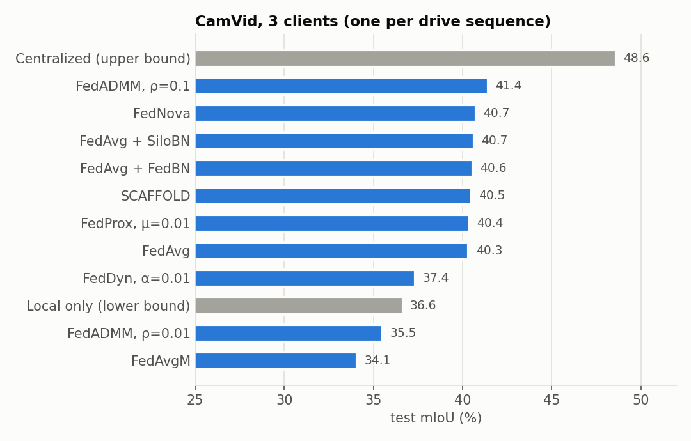
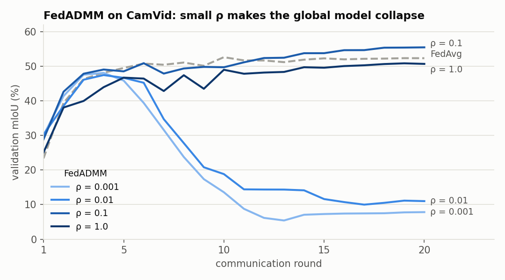
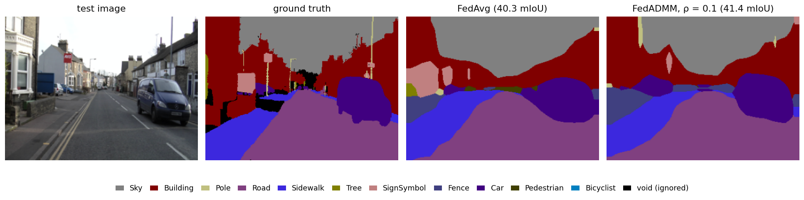
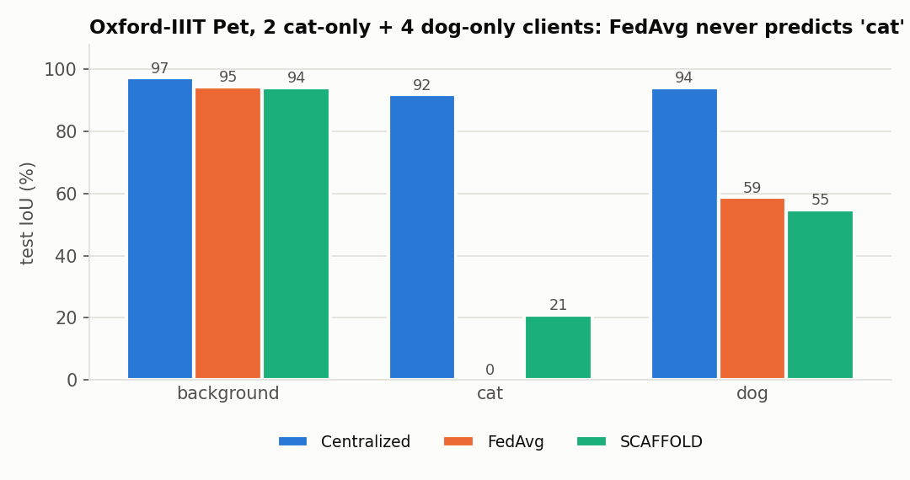

# Federated semantic segmentation

I wanted to see how the usual federated optimizers do on semantic segmentation when the clients are really
different from each other, not a random split that only looks non-IID.

There are two setups:

- **CamVid** (11 classes). Each client is one drive sequence, so one car is one client. The clients differ in
  how their scenes look (one sequence is filmed at dusk). I used the standard SegNet split (367 / 101 / 233).
- **Oxford-IIIT Pet** (background / cat / dog). There are 6 clients, grouped by breed: 2 have only cats and
  4 have only dogs. This is a hard case of label skew.

I compared FedAvg, FedProx, FedADMM, FedDyn, SCAFFOLD, FedNova and FedAvgM. FedBN and SiloBN were also tried
for the BatchNorm layers. Training on all the data (centralized) is the upper bound, and training each
client alone is the lower bound. The model is DeepLabV3 with an ImageNet-pretrained MobileNetV3 backbone.
SegNet-Basic is included too.

## Results

All numbers are test mIoU, taken at the round with the best validation score. Each run is 20 rounds with one
seed. I ran the same FedADMM config twice and got 35.5 and 34.2, so a gap of about a point is noise.



**CamVid**

- Federation helps. FedAvg reaches 40.3, against 36.6 for local-only training. That is still 8 points below
  centralized (48.6).
- Most methods end up within a point of FedAvg. The clients are only mildly different (JS ≈ 0.02), so client
  drift isn't what holds the model back. FedBN and SiloBN don't change much here either.
- FedADMM depends heavily on ρ:



With ρ = 0.01 (the default from the paper) or 0.001, the global model peaks around round 4 and then
collapses. Meanwhile the clients' training loss keeps going down. The server model is θ = avg(wᵢ + yᵢ/ρ),
and yᵢ/ρ is roughly the sum of each client's drift so far. When ρ is small, the penalty is too weak to keep
wᵢ close to θ. The drift keeps adding up and the server keeps extrapolating along it. With ρ = 0.1 training is
stable, and it gives the best federated result (41.4), still improving at round 20. FedDyn with α = 0.01
collapses the same way, which makes sense because its server step has the same h/α form.

Here are FedAvg and the best federated model (FedADMM, ρ = 0.1) on the same test image:



Both models get the large regions right: road, sidewalk, sky and buildings. FedADMM outlines the van more
fully and finds a pole and the sign. FedAvg labels part of the white house as a sign and a tree. Neither model
gets the thin objects right, which matches the low per-class scores for Pole (≈ 8 IoU) and SignSymbol. This is
one image, though, and the overall gap between the two models (1.1 mIoU) is about the size of the run-to-run
noise.

- FedAvgM (server momentum 0.9) falls from 48 to 25 validation mIoU around rounds 10–12, and is still
  climbing back at round 20. It probably needs a smaller server learning rate.

**Pets**



- Centralized reaches 94.5. Every federated run lands between 50 and 57.
- The per-class scores show why. FedAvg, FedProx, FedDyn and SiloBN all score 0 IoU on *cat*: the global model
  labels every pet as a dog. Pixel accuracy is still 85%, which hides this. With 4 dog clients against 2 cat
  clients, and 3 clients picked each round, dogs most likely win the averaging.
- SCAFFOLD is the only method that gets some cats right (21 IoU, 56.7 mIoU). That fits what its control
  variates are designed for.
- FedADMM (ρ = 0.01) blew up. By round 12 the validation loss was NaN and the model predicted background
  everywhere, and the run crashed at round 18. Its partial history is in `results/`.

Every run is in [`results/`](results) with its config, per-round history, test metrics and plots. The full
table is in [`results/_summary/summary.md`](results/_summary/summary.md).

## Running it

**Colab:** open [`FedSeg_Colab.ipynb`](FedSeg_Colab.ipynb) on a GPU runtime and run all cells. The datasets
download automatically. Runs are saved to Drive, and if the session drops they pick up where they stopped.

**Locally:**

```bash
pip install -r requirements.txt
python run.py --dataset camvid --algorithm fedadmm --rho 0.1 --partition natural --num_clients 3 --rounds 20
python run.py --dataset pets --algorithm scaffold --num_clients 6 --clients_per_round 3
python compare.py --runs runs          # summary table and plots
python run.py --help                   # all options
```

`pytest tests/` checks the algorithms on a small quadratic problem whose optimum is known. FedAvg should drift
away from it, while FedADMM, FedDyn and SCAFFOLD should reach it.

```
fedseg/          algorithms, trainer, models, metrics, data loaders
experiments.py   experiment suites used by the notebook
results/         every run (no checkpoints)
figures/         plots in this README
```

## References

- McMahan et al., [FedAvg](https://arxiv.org/abs/1602.05629), AISTATS 2017
- Li et al., [FedProx](https://arxiv.org/abs/1812.06127), MLSys 2020
- Gong, Li & Freris, [FedADMM](https://arxiv.org/abs/2204.03529), ICDE 2022
- Acar et al., [FedDyn](https://arxiv.org/abs/2111.04263), ICLR 2021
- Karimireddy et al., [SCAFFOLD](https://arxiv.org/abs/1910.06378), ICML 2020
- Wang et al., [FedNova](https://arxiv.org/abs/2007.07481), NeurIPS 2020
- Li et al., [FedBN](https://arxiv.org/abs/2102.07623), ICLR 2021
- Fantauzzo et al., [FedDrive](https://arxiv.org/abs/2202.13670), IROS 2022
